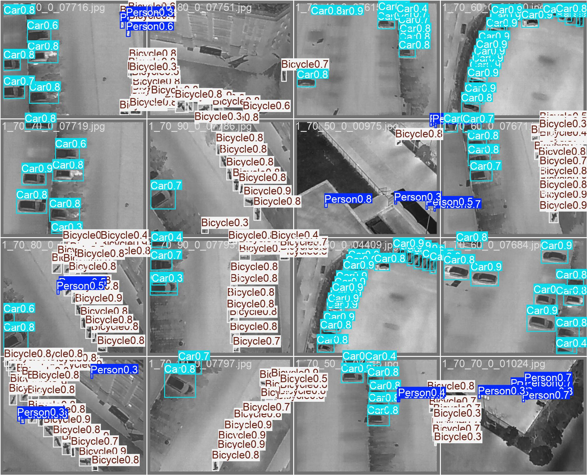
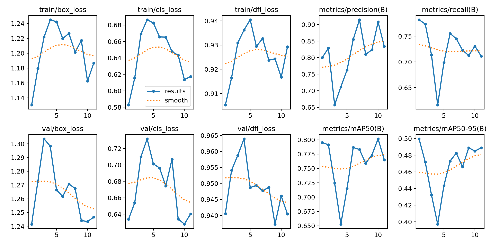
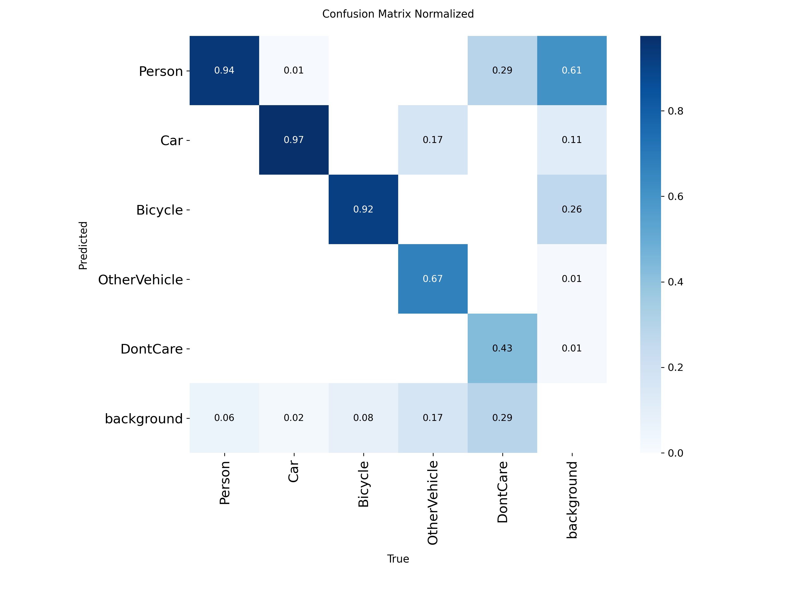

# 🛸 Thermal Sentinel: High-Altitude Infrared UAV Object Detection with YOLO11

[](https://github.com/ultralytics/ultralytics)
[](https://pytorch.org/)
[](LICENSE)

**Thermal Sentinel** is an aerial computer vision system designed for autonomous object detection in **High-Altitude Infrared Thermal (HIT-UAV)** imagery captured by drones. Built using the state-of-the-art **YOLO11s** architecture, the model identifies pedestrians, vehicles, and cyclists in night-time, degraded visual, and low-contrast surveillance environments.

---

## 📌 Detection Results
Validation predictions captured by high-altitude UAV thermal sensors:


---

## 🏷️ Detected Categories
The model is trained to recognize 5 target classes from aerial viewpoints:
1. `Person`
2. `Car`
3. `Bicycle`
4. `OtherVehicle`
5. `DontCare`

---

## ⚙️ Thermal-Aware Training Strategies

Standard data augmentations fail on infrared images because heat signatures contain no chrominance (color) information. This pipeline employs thermal-specific strategies:
- **Zero Color Jittering:** Disabled hue and saturation augmentations (`hsv_h = 0.0`, `hsv_s = 0.0`) to avoid injecting unrealistic artifacts.
- **Controlled Value Shifting:** Enabled intensity modulation (`hsv_v = 0.4`) to simulate diverse ambient thermal contrasts.
- **Two-Stage Annealing:** 
  - **Phase 1:** Trained for 50 epochs with baseline warmup.
  - **Phase 2:** Fine-tuned for an additional 20 epochs with decayed learning rate (`lr0 = 0.001`) to stabilize convergence on subtle thermal signatures.

---

## 📊 Evaluation & Training Metrics

### Convergence & Loss Progression


### Normalized Confusion Matrix


---

## 🚀 Quick Setup

### 1. Clone & Install
```bash
git clone https://github.com/AmirhosseinBagherinia-dl/thermal-sentinel-yolo11.git
cd thermal-sentinel-yolo11
pip install -r requirements.txt
```

### 2. Download Pretrained Weights
Download `best.pt` from [Google Drive](https://drive.google.com/file/d/1qMIDt8Vol9cJlj0FJl5xwS5ctx_ZTUbo/view?usp=sharing) and place it in the project root directory.

### 3. Run Inference
```bash
python inference.py --weights best.pt --source path/to/thermal_image.jpg --conf 0.25
```

---

## 📁 Dataset
This project uses the [HIT-UAV Dataset (Kaggle)](https://www.kaggle.com/datasets/pandrii000/hituav-a-highaltitude-infrared-thermal-dataset).

---

## 📓 Interactive Notebook
The end-to-end training and evaluation pipeline can be viewed in `drone_project.ipynb`.